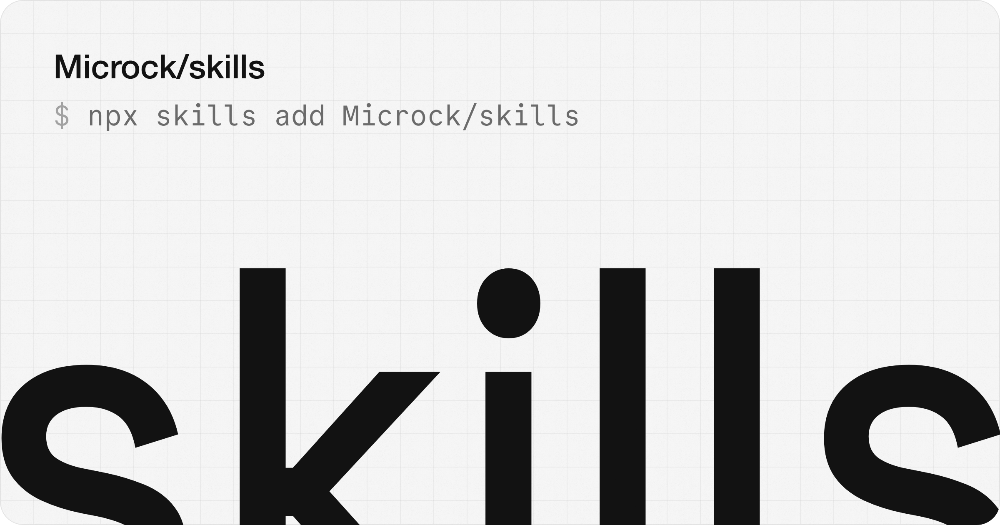

<a href="https://skills.micr.dev">
  <picture>
    <source media="(prefers-color-scheme: dark)" srcset="assets/banner-dark.png">
    
  </picture>
</a>

A collection of agent skills by Microck.

## Install

```sh
npx skills add Microck/skills
```

## Skills

- [micr-research](skills/micr-research/SKILL.md): find and verify external evidence from primary sources, repositories, Reddit threads, and media using your configured providers.
- [micr-usage-widget](skills/micr-usage-widget/SKILL.md): build iPhone home screen widgets that show how much of your AI subscriptions and other services you have left, so you stop checking each dashboard separately.
